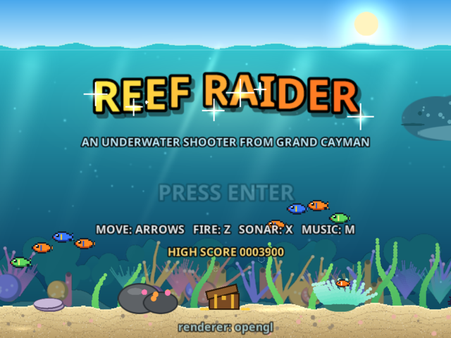
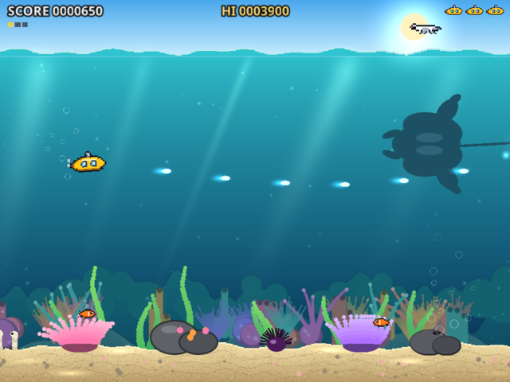
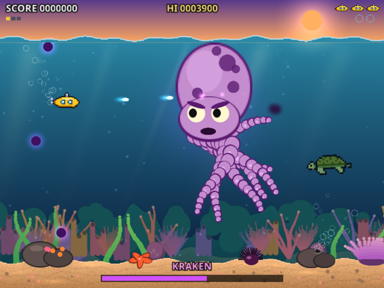
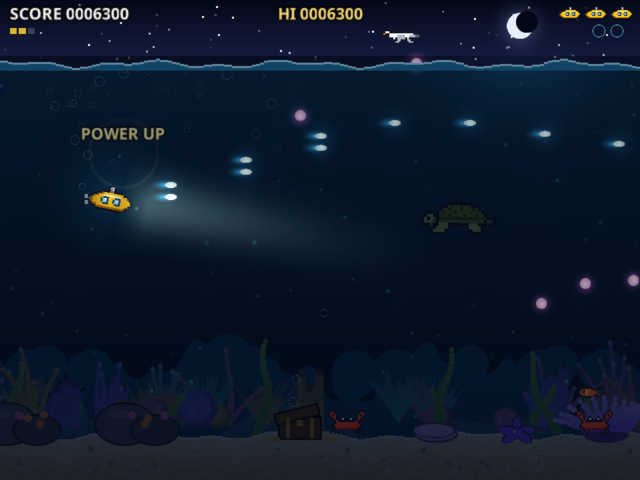

# Reef Raider

An original side-scrolling underwater shooter for the **R36S** handheld (ArkOS), written in C with SDL2.
It also builds as a desktop window for testing on a laptop.

Pilot a little yellow sub through a Grand Cayman reef. You'll face fish schools, pufferfish, jellyfish, crabs,
diving gulls and barracuda, with a Kraken boss at the end of each stage. Stages cycle through Morning Reef,
Sunset Drop-off and Night Dive. A *Moose Works* studio splash plays at launch.



| | |
|---|---|
|  |  |
|  |  |

## Quick install (no compiling)

1. Download `ReefRaider-R36S-v1.0.zip` from the [Releases page](https://github.com/clydesdal/R36S_reefraider/releases).
2. Unzip it and copy everything inside its `ports/` folder (`Reef Raider.sh` and the `reef/` folder) into the
   `ports` folder on your card's **EASYROMS** partition.
3. Put the card back in, restart EmulationStation (or reboot), and launch **Reef Raider** from **Ports**.

Tested on an R36S running ArkOS. The binary needs only SDL2 and glibc 2.27+, so other R36S Linux firmware
with a Ports menu should work too. If it doesn't start, `ports/reef/log.txt` says why.

## How it draws

Everything goes through `SDL_Renderer` textures, and nothing is drawn pixel by pixel on the CPU:

- Pixel-art sprites and the scenery layers are baked into textures at startup, so there are no asset files.
- Text comes from a signed-distance-field font (Noto Sans, OFL) that is baked into outlined glyph atlases.
- Glows and sparks use additive blending.
- The night stage is lit through a render target with a custom blend mode.

On the R36S, SDL picks **opengles2** on the Mali-G31 GPU and holds a steady 78 fps, the panel's refresh rate.
Game logic runs at a fixed 60 Hz.

## Controls

| Action | R36S | Laptop |
|---|---|---|
| Move | D-pad / left stick | Arrows / WASD |
| Fire | A, B or R1 | Z / Space |
| Sonar (smart bomb) | X or L1 | X |
| Music on/off | Y | M |
| Start / pause | Start | Enter |
| Quit | Select + Start | Esc |

## Building

### Laptop (Linux, SDL2 installed)

```sh
reef/host.sh && (cd reef && ./reef_host)
```

### R36S (cross-compile on Linux)

`build.sh` uses the host's **clang + lld**, plus a sysroot unpacked from Debian buster arm64 packages
(glibc 2.28, SDL2 2.0.9 headers). ArkOS ships glibc 2.30 and SDL2 2.30, so binaries built against the
older sysroot run on it. The sysroot isn't in the repo. To recreate it:

```sh
mkdir -p toolchain/debs toolchain/sysroot && cd toolchain/debs
M=http://archive.debian.org/debian/pool/main
for p in g/glibc/libc6_2.28-10+deb10u1 g/glibc/libc6-dev_2.28-10+deb10u1 \
         g/gcc-8/libgcc1_8.3.0-6 g/gcc-8/libgcc-8-dev_8.3.0-6 \
         g/gcc-8/libstdc++6_8.3.0-6 g/gcc-8/libstdc++-8-dev_8.3.0-6 \
         libs/libsdl2/libsdl2-2.0-0_2.0.9+dfsg1-1 libs/libsdl2/libsdl2-dev_2.0.9+dfsg1-1 \
         l/linux/linux-libc-dev_4.19.249-2; do
  curl -LO "$M/${p}_arm64.deb"
done
for d in *.deb; do dpkg-deb -x "$d" ../sysroot || bsdtar -xOf "$d" 'data.tar.*' | tar -xJ -C ../sysroot; done
cd ../..
./build.sh reef
```

### Installing on the R36S

Copy the `reef/` folder (the `reef` binary is all it needs) into `EASYROMS/ports/`, and copy
`reef/Reef Raider.sh` to `EASYROMS/ports/`. Restart EmulationStation, then launch **Reef Raider** from Ports.
The game writes `log.txt` (renderer name, fps) and `hiscore.txt` next to the binary.

## Test hooks (environment variables)

| Variable | Effect |
|---|---|
| `REEF_AUTO=1` | autopilot, invincible, skips the menus |
| `REEF_STAGE=n` | start at stage n (0 = morning, 1 = sunset, 2 = night) |
| `REEF_BOSS=1` | go straight to the Kraken |
| `REEF_LEN=secs` | stage length before the boss (default 70) |
| `REEF_NOSPLASH=1` | skip the studio splash |
| `REEF_CREATURE=k` | first background creature: 0 turtle, 1 manta, 2 whale shark, 3 bait ball |
| `REEF_SHOT=out%d.bmp REEF_SHOT_AT=2,5,9` | save screenshots at those game times, then quit |

For headless screenshots, add `SDL_VIDEODRIVER=offscreen SDL_AUDIODRIVER=dummy`.
